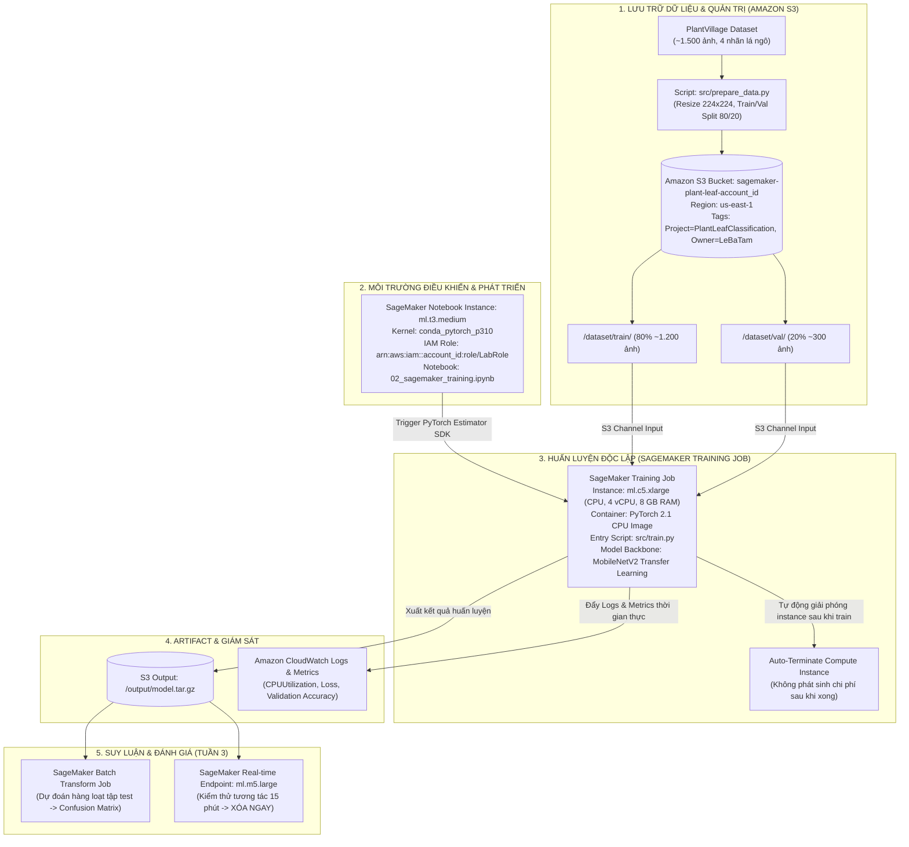

# KIẾN TRÚC HỆ THỐNG (SYSTEM ARCHITECTURE)
**Đề tài:** Phân loại bệnh lá cây bằng Transfer Learning trên AWS SageMaker  
**Môn học:** Cloud - Đợt 1 - 2026-2027 · GVHD: Huỳnh Xuân Phụng  
**Môi trường:** AWS Academy Learner Lab (`us-east-1`, IAM Role: `LabRole`)

---

## 1. SƠ ĐỒ KIẾN TRÚC TỔNG THỂ (MERMAID ARCHITECTURE DIAGRAM)



---

## 2. GIẢI TRÌNH CÁC DỊCH VỤ VÀ THÀNH PHẦN AWS SỬ DỤNG

### 2.1. Amazon S3 (Simple Storage Service)
* **Tên Bucket quy chuẩn:** `sagemaker-plant-leaf-<ACCOUNT_ID>` tại Region `us-east-1`.
* **Cấu trúc lưu trữ phân cấp:**
  * `dataset/train/`: Chứa các thư mục con theo tên nhãn (`Corn___Healthy`, `Corn___Common_Rust`, `Corn___Gray_Leaf_Spot`, `Corn___Northern_Leaf_Blight`).
  * `dataset/val/`: Chứa tập ảnh kiểm định phục vụ tính toán Validation Loss và Accuracy sau mỗi epoch.
  * `output/`: Nơi SageMaker lưu trữ `model.tar.gz` sau khi hoàn thành Training Job.
* **Quy chuẩn Tagging:**
  * `Project = PlantLeafClassification`
  * `Owner = LeBaTam`

### 2.2. Amazon SageMaker (Training with Script Mode)
* **Cơ chế Script Mode:** Tách biệt hoàn toàn máy làm việc (Notebook `ml.t3.medium`) và máy tính toán (Training Instance `ml.c5.xlarge`).
  * File `src/train.py` được truyền vào container của SageMaker cùng với dữ liệu tải tự động từ S3 mount vào `/opt/ml/input/data/`.
  * Sau khi hoàn tất, model được lưu vào `/opt/ml/model/`, SageMaker tự động đóng gói thành `model.tar.gz` và tải lên S3, sau đó **hủy ngay lập tức instance `ml.c5.xlarge`** để tiết kiệm 100% chi phí.
* **Lý do chọn `ml.c5.xlarge`:**
  * Thuộc họ Compute-Optimized, tích hợp tập lệnh Intel AVX-512 chuyên tối ưu phép nhân ma trận cho Deep Learning trên CPU.
  * Chi phí thấp (~$0.204/giờ) và nằm trong giới hạn quota vCPU của AWS Learner Lab.

### 2.3. IAM LabRole & Cơ chế Bảo mật
* Không tạo mới IAM Role (do tài khoản Learner Lab chặn quyền `iam:CreateRole`).
* SageMaker Notebook và Training Job sử dụng trực tiếp:
  ```text
  arn:aws:iam::<ACCOUNT_ID>:role/LabRole
  ```
  Role này đã được cấp quyền truy cập đầy đủ vào S3, SageMaker và CloudWatch.

### 2.4. Amazon CloudWatch
* Tự động thu thập log của Training Job theo stream `/aws/sagemaker/TrainingJobs`.
* Giám sát các chỉ số phần cứng: `CPUUtilization`, `MemoryUtilization`.
* Thiết lập CloudWatch Billing Alarm cảnh báo chi phí.
